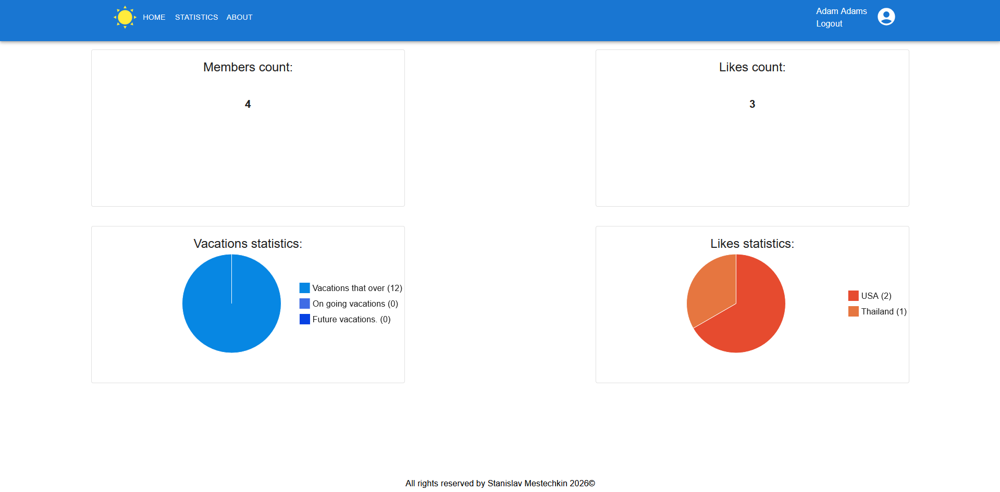
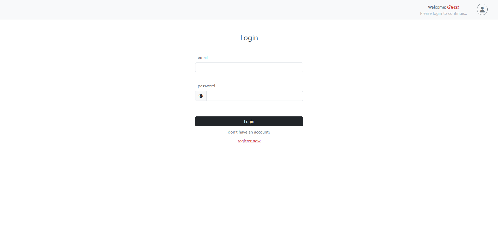
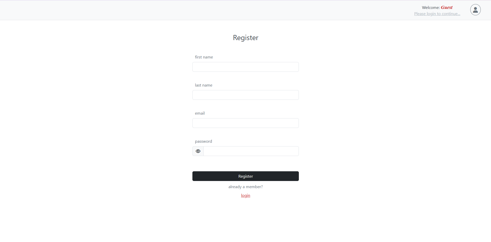
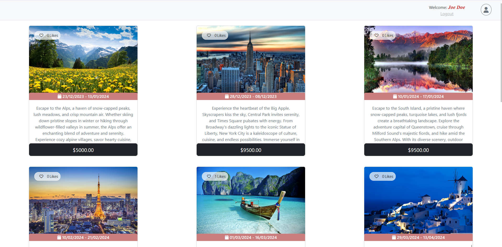
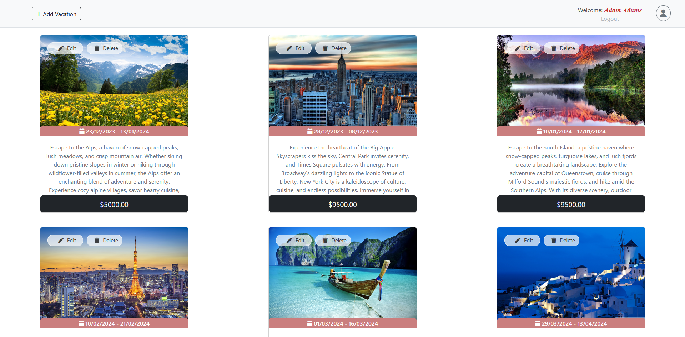
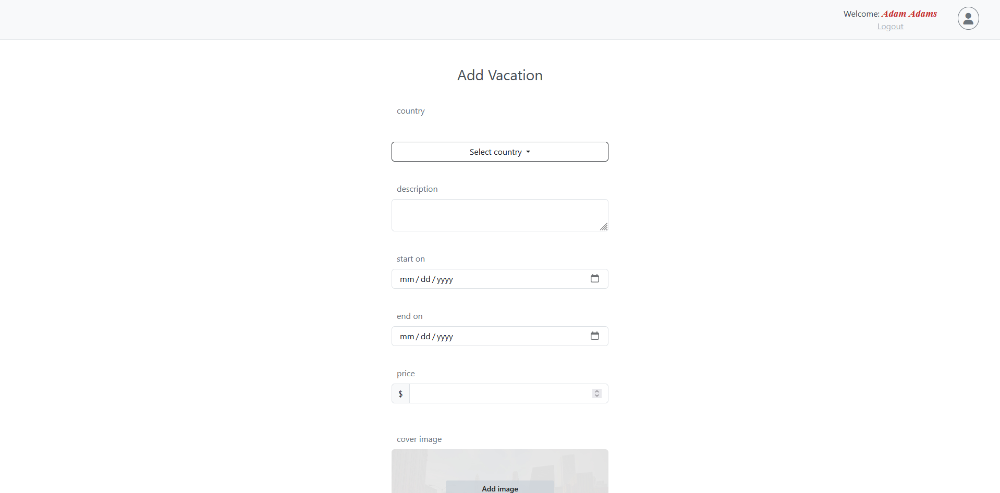
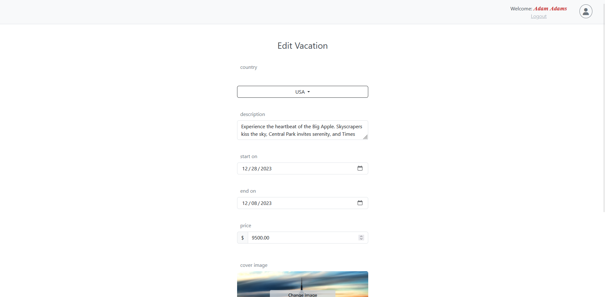
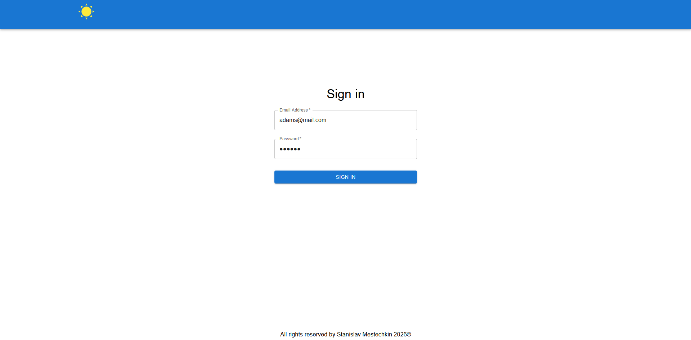
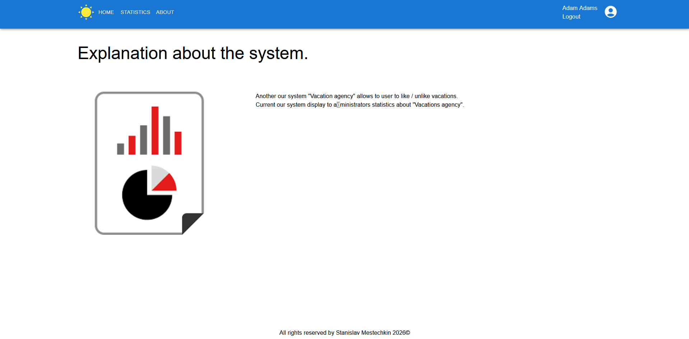
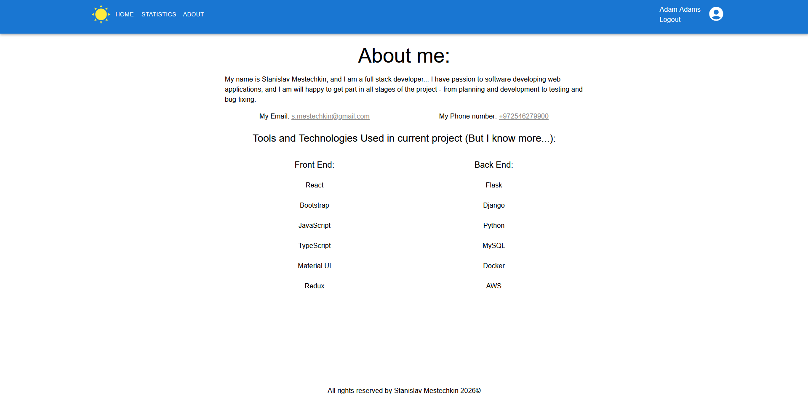

# Vacations Agency

A containerized vacation agency platform featuring a **Flask application** for customer registration, vacation browsing, likes, and administrator vacation management, alongside a **React + Django statistics dashboard** for agency administrators. Both applications use a shared MySQL database.



## Features

### Customer application — Flask

- Register an account and sign in.
- Browse vacation offers with destination photos, travel dates, descriptions, and prices.
- Like or unlike vacations.
- See the number of likes on vacation cards.

### Vacation administration — Flask

- Access a separate administrator interface.
- Add new vacation offers with destination, description, dates, price, and cover image.
- Edit existing vacation details and cover images.
- Delete vacation offers.

### Agency statistics — React + Django

- Sign in to the agency-facing application.
- View registered member and total like counts.
- See vacations grouped by status: past, ongoing, and upcoming.
- Visualize likes by destination.

## Technology Stack

| Area | Technologies |
| --- | --- |
| Customer application | Python, Flask, server-rendered frontend |
| Statistics frontend | React, JavaScript / TypeScript, Material UI |
| Statistics API | Python, Django |
| Database | MySQL |
| Containers | Docker, Docker Compose |

## Architecture

```text
Customer / admin browser          Agency browser
       |                                |
       v                                v
Flask application                React frontend
(customers + admins)                    |
       |                                v
       |                            Django API
       |                                |
       +-------------+------------------+
                     |
                     v
                   MySQL
```

The Flask application handles customer-facing operations and vacation administration, while React requests statistics from the Django API. Both backend services work with the shared database.

## Screenshots

### Customer application (Flask)

**Login**



**Registration**



**Vacation catalog and likes**



### Vacation administration (Flask)

**Administrator vacation list**



**Add vacation**



**Edit vacation**



### Agency statistics (React + Django)

**Sign in**



**Home**



**Statistics**


**About**



## Repository Structure

```text
vacations-agency/
├── Django/              # Statistics backend API
├── Flask/               # Customer and administrator application
├── Mysql/               # Database configuration
├── React/               # Agency statistics frontend
├── docs/
│   └── screenshots/     # Customer, admin, and dashboard screenshots
├── docker-compose.yml   # Service orchestration
└── LICENSE
```

## Getting Started

### Prerequisites

- Git
- Docker and Docker Compose

Clone the repository:

```bash
git clone https://github.com/StasX/vacations-agency.git
cd vacations-agency
```

Review `docker-compose.yml` and configure database credentials before running the services. The current container configuration is development-oriented and should be reviewed before public deployment.

```bash
docker compose up -d --build
```

Inspect the services and logs:

```bash
docker compose ps
docker compose logs -f
```

Consult the published ports in `docker-compose.yml` to access the customer application and statistics frontend.

Stop the application:

```bash
docker compose down
```

> **Warning:** `docker compose down -v` also removes persistent volumes, including database data.

## Possible Improvements

- Serve the production React build with Nginx.
- Move secrets and database credentials into environment variables.
- Restrict public exposure of internal services.
- Add automated tests and CI/CD checks.
- Document database ownership and migrations between the two backends.

## License

Licensed under the [Apache License 2.0](LICENSE).

## Author

[StasX](https://github.com/StasX)
